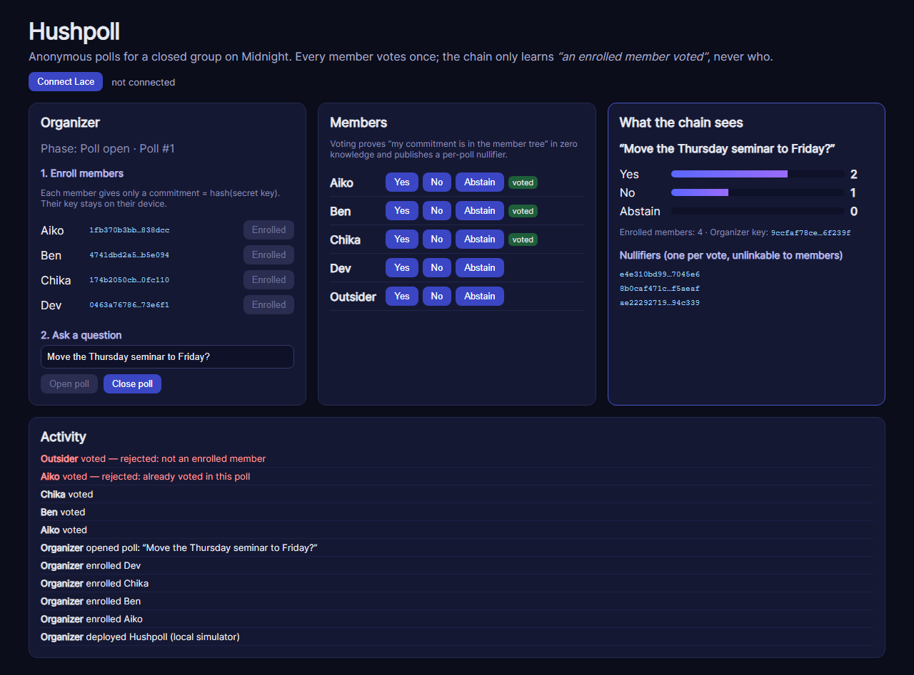

# Hushpoll — anonymous polls for a closed group, on Midnight

Built for the Midnight Buildathon Wave 3 (AKINDO). Licensed under Apache-2.0. Topic: `midnightntwrk`.

- **Live demo: https://class-now.github.io/hushpoll/** (demo mode, simulated ledger: the compiled circuits run in the browser, the ledger is in memory)
- Demo video (2 min, narrated): [docs/hushpoll-demo.mp4](docs/hushpoll-demo.mp4)
- Slides: [docs/hushpoll-slides.pdf](docs/hushpoll-slides.pdf)

## The problem

A seminar, club or research lab wants honest answers ("Is the workload too heavy?", "Should we drop this rule?").
Ordinary forms make people choose between two bad options. Either the form is open to anyone, so the results can be gamed. Or it checks who you are, so people stop being honest.
Hushpoll proves **"this vote came from an enrolled member, and that member has not voted yet"** without revealing **which** member.

## How privacy shapes the design

| Data | Where it lives | Who sees it |
|---|---|---|
| Member secret key | Private state on the member's device | Only the member |
| Member commitment `H("hushpoll:member", sk)` | Public `HistoricMerkleTree` | Everyone, but it does not reveal sk, and a vote does not show which leaf was used |
| Merkle path | Computed locally by a witness and checked inside the ZK proof | Nobody |
| Vote nullifier `H("hushpoll:nullifier", poll, sk)` | Public `Set` | Everyone; it cannot be linked to a commitment or to the member's nullifiers in other polls |
| Choice and tallies | Public counters | Everyone (the result is meant to be public) |

Midnight's dual-ledger model is used directly. The public ledger holds the tree, the nullifiers and the tallies. The private side holds only the secret key. The `vote` circuit joins the two through `disclose()`, which is applied only to the Merkle root check, the nullifier and the choice.

## Contract (`contract/src/hushpoll.compact`)

- `enroll(commitment)`: organizer only, during setup. Adds a member commitment to the tree.
- `open(question)` / `close()`: organizer only. Starts or ends a poll. `close` moves to the next poll number, so every member gets a fresh nullifier.
- `setQuorum(n)`: organizer only, while no poll is open. Sets the minimum number of ballots for a valid result (0 disables it). When a poll closes, the contract compares the public ballot counter with the quorum and stores `quorumMet`, so a "result" from two votes in a ten-person seminar is marked as not valid on chain instead of being read as the group's decision.
- `addInvite(hash(code))`: organizer only, during setup. Publishes the hash of a one-time invite code; the code itself goes to the member off-chain (a link or a QR on paper).
- `redeem(code)`: anyone holding an unused code, during setup. Proves the code matches a published hash, spends it, and adds the caller's own commitment to the tree. The member never has to send anything to the organizer, and a code works once.
- `vote(choice)`: any enrolled member, once per poll. The checks inside the proof are:
  1. the witness path's leaf equals the caller's own commitment, so a member's path cannot be reused by someone else;
  2. the path's root is a root of the member tree;
  3. the nullifier is not already in the set.
- Pure helpers `memberCommitment`, `voteNullifier`, `inviteHash` and `organizerKey` are exported so the UI can compute values to enroll.

## Run it

Tested with Compact toolchain 0.36.1 (CLI 0.5.3) and `@midnight-ntwrk/compact-runtime` 0.21.0 on Node 20.

```bash
# Compact toolchain (https://docs.midnight.network)
compact update
cd contract
npm install
npm run compact     # compiles to src/managed/hushpoll (7 circuits)
npm run typecheck
npm test            # simulation tests, no network needed (11 tests)
npm run demo        # one full round in the terminal: enroll, join with an invite code, open, vote, reject a double vote and an outsider, close
```

### Web UI (`ui/`)



```bash
cd ui
npm install
npm run dev         # needs contract/ compiled first
```

The UI runs the compiled circuits in the browser through `compact-runtime` (the same code the proof server proves), with the ledger kept in memory. Three panels show the organizer flow (enroll commitments or hand out one-time invite codes, open and close a poll), the member flow (vote yes/no/abstain; an outsider is included to show rejection), and **what the chain sees**: the question, the tallies, the member count and the list of nullifiers, none of which point to a member. "Connect Lace" detects the Midnight Lace wallet through the DApp connector (`window.midnight.mnLace`).

The tests in `contract/src/test/hushpoll.test.ts` cover the following:
- votes are counted once per member;
- a second vote in the same poll is rejected;
- non-members are rejected;
- only the organizer can manage polls;
- a member can vote again in the next poll with an unlinkable nullifier;
- a closed poll below the quorum is marked as not valid, and one that reaches it as valid;
- the quorum cannot be changed during an open poll or by a member;
- a member can enroll once with an invite code, a spent or unknown code is rejected, and only the organizer can publish codes;
- invite codes are not accepted once a poll has opened.

### Deploy on a Midnight network with real proofs (`deploy/`)

`deploy/` deploys the contract with midnight-js 5.0.0 and plays one full round as real transactions: every enroll, open, vote and close is proved by the proof server and finalized on chain. Each member is a separate private state with its own secret key, standing in for separate devices.

```bash
cd deploy
npm install                       # Node >= 22.12
node scripts/sync-contract.mjs    # copies the compiled contract from ../contract
npm run chain:up                  # local Midnight network: node 2.1.101, indexer 4.4.101, proof server 9.0.2-rc.0 (Docker)
npm run local                     # deploy + one round, about 4 minutes
```

Output of a run (full log in [`docs/local-deploy-run.txt`](docs/local-deploy-run.txt)):

```
deployed at b31570b9…77db0e (block 56)
enrolled alice / bob (blocks 61, 66)
organizer published invite hash f7307b0f… (block 71)
chika redeemed the invite code and enrolled herself (block 77)
an outsider reuses the spent code: rejected — failed assert: invalid or used invite code
after enrollment: phase=SETUP poll=1 members=3
quorum set to 2 ballots (block 82), poll opened (block 86)
alice, bob, chika voted with ZK proofs (blocks 91, 96, 101)
after three votes: phase=OPEN poll=1 members=3 yes=2 no=1 abstain=0 nullifiers=3 ballots=3
alice votes again: rejected — failed assert: already voted in this poll
an outsider tries to vote: rejected — Error executing circuit 'vote'
final: phase=CLOSED poll=2 members=3 yes=2 no=1 abstain=0 nullifiers=3 ballots=3 quorum=2 quorumMet=true
```

The chain only ever sees the commitments, one invite hash, three nullifiers and the tallies; nothing in the ledger links a vote to a member, and the invite code itself never appears on chain.

## Roadmap

- Wave 3 (done): contract, simulation tests, terminal demo and a web UI for the organizer and member flows.
- Wave 3 (done): deployment with midnight-js 5.0.0 on a local Midnight network (ledger v9), one full round as proved transactions.
- Next: the same `deploy/` flow on the public testnet with a Lace-funded wallet, and the web UI switched from the in-memory ledger to these providers.
- Wave 3 (done): a quorum (minimum ballots) set by the organizer and checked on chain when a poll closes, in the contract, tests, terminal demo, web UI and the on-chain round (`docs/quorum.png`).
- Next: invite links that carry a one-time enrollment code. Keeping tallies hidden until N votes have been cast, which keeps small groups from being de-anonymised by timing. Rating scales beyond yes/no/abstain.

## Who it is for

University seminars and student clubs (course feedback), small companies (pulse surveys), and DAOs that want one-member-one-vote without publishing who voted what.

## Attribution

Built on the Midnight Network Compact language and runtime (https://github.com/midnightntwrk). The membership and nullifier pattern follows the Midnight documentation ("Restricting a circuit to a group", "The commitment/nullifier pattern").
